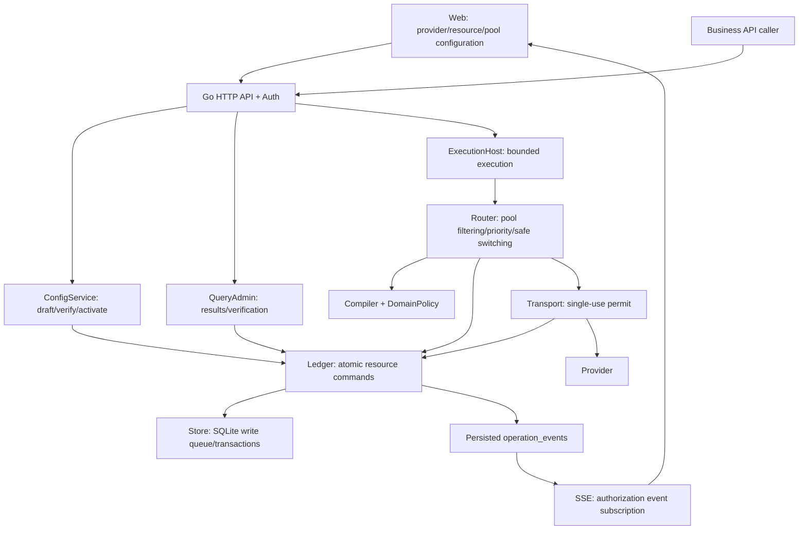

# Web, Go server, and module design

Version: V0.8. Basis: [DESIGN](../DESIGN.md), [Resource Pool](07-POOLS-AND-CONFIG.md), [Runtime Hooks](10-HOOKS.md), [Go contracts](contracts.go).

## 1. Engineering and deployment

| Part | Choice | Responsibility |
|---|---|---|
| Web | React, TypeScript strict, Vite, npm lock | Configuration and observation; does not call providers, does not compute authoritative balances, does not decide switching on its own |
| Server | Go 1.27 series, net/http, database/sql, go.sum | Authentication, configuration, dispatch, outbound calls, accounting, recovery, HTTP/SSE |
| Reference Store | SQLite + modernc.org/sqlite | Same-host WAL, FULL, foreign_keys; one write connection plus an independent read-only connection pool |
| Network | Controlled net/http Transport | Forbids hidden request replay/redirects; reuses connections only on allowed paths |
| Protocol | HTTP JSON + SSE | JSON quantities as decimal strings; persisted events carry sequence numbers |
| Delivery | Go server binary + web/dist | Can be hosted same-origin; Node participates only in the Web build, not in backend runtime |

Go version basis: [official release history](https://go.dev/doc/devel/release). Standard HTTP, Context, and connection pool behavior basis: [net/http](https://pkg.go.dev/net/http), [context](https://pkg.go.dev/context), [database/sql connection management](https://go.dev/doc/database/manage-connections). Driver basis: [modernc.org/sqlite](https://pkg.go.dev/modernc.org/sqlite). Frontend engineering basis: [React TypeScript](https://react.dev/learn/typescript), [Vite](https://vite.dev/guide/). These support the technology choices; they do not prove performance targets are met.



Web and server are independent build units; initially the server is a modular monolith internally. Ledger and Transport are responsibility boundaries, not split into cross-service transactions.

## 2. Directory layout and specific responsibilities

```text
server/
  go.mod / go.sum
  cmd/ant-server/main.go
  internal/api/{router,middleware,config,operations,events}.go
  internal/application/{router,config_service,query_admin}.go
  internal/domain/{types,fingerprint,result_resolver,rank_candidates}.go
  internal/domain/resources/{counter,window,occupancy,waterfall}.go
  internal/domain/pools/{compile,eligibility,priority}.go
  internal/ledger/{ledger,validate_change,commands/}.go
  internal/store/sqlite/{store,writer,statements,migrate}.go
  internal/transport/{http_transport,permit,encoded_validator}.go
  internal/adapters/<provider>/
  internal/runtime/{host,supervisor,stream_hub,clock}.go
  internal/security/{auth,sessions,secrets}.go
  migrations/ / tests/{integration,fault,live}/
web/
  package.json / package-lock.json
  src/app/{routes,providers}.tsx
  src/features/{providers,resources,pools,operations}/
  src/api/{client,types,events}.ts
  src/components/ / src/styles/tokens.css / src/locales/{zh,en}.json
  tests/ / e2e/
```

API is responsible for DTOs, authorization, request quotas, and error mapping; ConfigService manages draft/validation/activation; Router manages execution planning and legitimate switching; Domain only computes rules; Ledger validates and commits; Store has exclusive ownership of SQL; Transport has exclusive ownership of provider networking; Adapter only encodes/decodes; ExecutionHost holds running tasks and cancellers; QueryAdmin does not resend. Go interfaces are defined at the consumer side and injected explicitly at the composition root.

domain→api/store/transport is forbidden, adapters→HTTP/SQL/secret is forbidden, api→drivers is forbidden, and Web importing server code or secrets is forbidden. Wire DTOs are kept separate from domain/persistence objects; Go interfaces are never used directly as JSON.

## 3. Leveraging Go's concurrency model

ExecutionHost controls active tasks with a semaphore, starting cap 128; each active operation has one coordinating goroutine, and response decoding, persistence, and subscription are each bounded. Above the cap, Busy is returned before claim; this is not a quota wait queue. Configuration/query HTTP requests also have concurrency and body size limits.

The SQLite Store uses a single write connection with SetMaxOpenConns(1) and two bounded channels: control/settlement and ordinary writes, total cap 512 with 128 slots reserved for control. Each round, the writer goroutine processes at most 8 consecutive control items before processing one ordinary item, preventing permanent starvation of ordinary items; an entire command still runs serially inside a short transaction. The read-only connection pool starts at 4 with query_only; queries have timeouts and keyset pagination, and never wait on the network or consumers inside a read snapshot.

Overload only rejects work that has not yet acquired ownership; settlement of an accepted operation must never be silently dropped. Task limits, reserved control slots, and shutdown drain ensure it has an outlet; if storage is unavailable, recover by querying with the original ID rather than falsely reporting success. After queue submission, the caller's context ending does not prove the transaction was not committed; check the receipt or query.

After atomic activation, the immutable compiled configuration is published via atomic.Pointer, reducing lock contention for ordinary planning; it is only a planning snapshot — prepare/authorize/consume still re-check poolVersion/controlVersion/credentials and resources against the database. Balances are never put into an authoritative in-memory cache.

Shared connection pools, cached prepared statements, merged-output transactions, short transactions, batched lease renewal, and pagination reduce overhead. No unbounded goroutines, unbounded channels, long transactions, or lifecycle objects kept alive via sync.Pool. pprof, benchmem, race, goroutine counts, queue waits, lock waits, and p95/p99 are measured at T6; Go does not automatically break through SQLite single-writer throughput.

## 4. Lifecycle and engineering gates

Startup: permissions/secret master key→migrations→restore_guard/activate configuration→explicit Adapter registration→start supervisor/writer/sweeper→API ready. With no executable configuration, login, configuration, and viewing still work; business outbound calls are rejected. The default is a single resident server; multi-process on the same host still relies on database guards.

Shutdown: close submission entrances→fixed-duration wait/request cancellation→stop local provider reads→commit known/conservative settlements→stop heartbeat/sweeping→drain the write queue→close connections. Hard exit is left to lease sweeping; never infer that a provider has stopped. The server must not be bound to the lifetime of a particular browser session.

T1 establishes the Makefile: check (gofmt/vet/dependency check/Web type build), test-contract, test-integration, test-fault, test-web, test-e2e, bench, build. Missing tests cause a non-zero exit. The backend uses testing/httptest, and races are checked with go test -race; frontend components use Vitest/Testing Library, the real UI uses Playwright, executed after versions are pinned. Initially no multiple SDK release packages are generated, and no microservice deployment is done.
