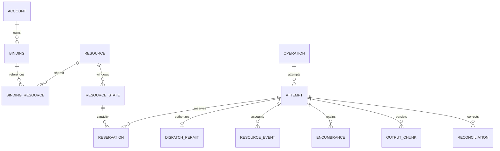

# Data relationships, transactions, and idempotency

Reference migration: [001-initial.sql](sql/001-initial.sql). This chapter defines entity relationships for the single-machine SQLite profile; another Store must implement the same relationships/guards rather than inventing different business semantics.

## 1. Relationships and identity



Accounts and resources are the actual shared subjects; balances must not be cloned per calling namespace. The operation primary key is namespace/operationId; attempt and permit are UUIDs. binding_resources expresses AND constraints such as total quota + key rate. namespace_grants decides who may use/read these bindings or accounts; granting a new namespace does not create new capacity.

## 2. Specific purpose of each table

| Table | State and key constraints | Read/write locations |
|---|---|---|
| config_revisions/active_config | Immutable configuration body + one activation pointer, activation version monotonic | ConfigAdmin validates, then Ledger activates in the same transaction |
| accounts/bindings/resources/binding_resources | Stable identity, enabled, credential version, rule definitions/shared references | Configuration transactions; admission and pre-send read current state |
| namespace_grants | principal/namespace/permission/scope unique | Trusted administrative initialization; Ledger checks each permission |
| guard_states | scope's current trusted revision/allowed/expiry/origin; older versions do not overwrite | recordGuardEvidence; prepare saves refs, permits read current state |
| resource_states | resource/window primary key, capacity, committed, adjustment, reserved, active, uncertain, version | Loaded/conditionally updated inside Ledger transactions |
| operations | running or four terminal states, cancellation intent, lease, fixed strategy, permit budget, result | claim/cancel/settle/sweep; terminal states cannot be revived |
| execution_plans | Fixed metering/mapping/upper bounds/configuration version snapshot, no secret body | Stored at the first prepare; settlement uses only the original plan |
| attempts | prepared/executing/terminal, requestDigest, guard refs, partial unique index guarantees a single active attempt | prepare/authorize/settle/sweep |
| reservations | Unique per attempt/resource/window, phase and quantity trackable | Preparation, window migration, authorization, settlement |
| dispatch_permits | One per attempt, granted/consumed/revoked, bound to runtime/generation/requestDigest | Generated by authorize; consume-permit consumes once |
| command_receipts | scope/commandId unique, inputHash prevents conflicts, results replayable | Idempotency management/settlement and events in the same transaction |
| secret_records/secret_refs | AES-GCM nonce/ciphertext; reference owner, namespace, current version and mask | Created or CAS-rotated in the same transaction; activation only accepts credential versions owned by this namespace |
| resource_events | append-only with per-aggregate deltas, metering time point/evidence | Accounting and aggregation in the same transaction; UsageEvent is the consume subset, Adjustment is the adjust subset |
| encumbrances | Occupancy/time attribution isolation, open/released, ending evidence | Created by unknown, released by reconcile with evidence |
| observations | Same resource window, origin/time point/local watermark/adjustment version | recordObservation; query/prepare read only valid observations |
| holds | Block by account/binding/credential/resource/business scope | Created by report/admission management, cleared with evidence |
| decision_records | Candidates/sort keys/versions/prepare race summary, explicit truncation | Rejection or prepare/authorization transactions; historical queries do not recompute |
| output_chunks | attempt/sequence unique, persisted bytes + SHA-256 | Same transaction writes the chunk, the first-segment visibility time point, and the `output_stored` reference event; identical sequence/bytes replay idempotently, conflicts rejected; paginated reads authorized per operation |
| reconciliations/audit_log | Appended verification, corrections, and operator | Administrative commands; the original OperationResult is not changed |
| runtime_control | restore_guard, control_version, clock watermark | Checked for new permits; backup recovery control; prevents stale versions |

The Resource owner's polymorphic reference cannot be expressed by a single SQL foreign key; compiler and the configuration transaction validate owner_kind/owner_id; the attempt's account/binding relationship has a composite foreign key. SQL constraints are only the floor; Ledger still validates I01–I10 and change kinds.

Billable resources and representable consumption aggregates use Go int64 in a unified minimum unit; intermediate computed values are verified with math/big or checked arithmetic; the quantization ratio is determined by Resource.quantum_exp and unit. The monetary example is USD micro-units, tokens are integers; all conversions happen in domain projection. SQLite numerics are limited to signed 64-bit; before updates, verify the range with math/big/overflow checks so SQLite integer arithmetic never overflows to REAL. The canonical decimal original value of an out-of-range external report is stored in `attempts.report_json` (`actualOutOfRangeDecimal`, a backward-compatible optional field); such a result does not write a fabricated `committed_units`, atomically releases the reservation, writes an `actual_out_of_range` resource hold, returns `unknown/UnknownOutcome` with exact `unrepresentableMetrics`, and blocks subsequent prepare/auto-continue. The report summary includes the original value and replays idempotently; old reports without the field remain readable. No new SQL columns or migrations are needed.

JSON quantities are encoded as decimal strings, Go fields are int64 with the json string tag, and the strict codec rejects overflow/floats; the browser does not convert to Number. state/version/time fields are validated against their respective ranges. Output bodies never enter logs or decision JSON; by default they are stored in the authorized database's chunks. Purging a body does not delete the operation identity, accounting, or unknown evidence.

## 3. Transaction execution template

```text
writer goroutine receives command
  validate trusted principal, schema, RPC size
  BEGIN IMMEDIATE
  read runtime_control and the current activation version
  if an idempotency ID exists: read receipt; same hash returns the old result, different hash rejected
  read operation/attempt → account/binding controls → read resources sorted by resourceId/windowKey
  check expectedState, owner/generation, lease, cancellation, permit/budget
  compute ResourceChangePlan with pure rules; verify invariants item by item
  insert events; conditionally update resources/attempt/operation; insert receipt/audit
  COMMIT
  return the committed result
```

The Go database/sql write pool is configured with the modernc driver's `_txlock=immediate`, foreign_keys/busy_timeout/WAL/FULL; each command runs BeginTx→pure rules and SQL→Commit, with Rollback on failure; all operations in the same transaction use sql.Tx, and using db.Exec again inside tx is forbidden. The DSN is generated by the composition root; arbitrary _pragma from the UI is not accepted. Driver parameters basis: [official API](https://pkg.go.dev/modernc.org/sqlite); single-writer transactions basis: [SQLite](https://sqlite.org/lang_transaction.html). Initial busy_timeout=10ms, command budget 50ms, at most 2 full rollback-and-retry rounds per transaction; when a response is unclear, check the receipt first and never resend business network calls. SQLite calls run in a dedicated writer goroutine and do not block API-handling goroutines; the single-writer bottleneck must still be measured in practice.

The read quote is a consistent read snapshot with no resource writes; prepare must recompute. On transaction failure the whole item rolls back; you cannot catch a single SQL error and keep writing. Consumption events and aggregates commit atomically; `initial baseline + event deltas = current aggregate` can be verified offline, but never replaces online indexed aggregation with a full-history scan each time.

StoreTx reads via `loadOperation/loadAttempt/loadResources/getPermit/getReceipt` and writes via `insertAttempt/insertReservation/appendEvent/insertReceipt/writeResult/applyResourceDelta/casConsumePermit`; the SQL for each method stays in server/internal/store/sqlite/statements.go, and Ledger handlers only orchestrate these typed methods. A transaction loads all relevant state as a whole; the execution coordination layer never uses quote results to update directly.

Example of the conditional update for counting reservations (occupancy-type uses capacity-reserved-active-uncertain instead):

```sql
UPDATE resource_states
SET reserved_units=reserved_units+:q, version=version+1
WHERE resource_id=:resource AND window_key=:window AND version=:expected
  AND capacity_units-committed_units-adjustment_units-reserved_units>=:q;
```

changes must be 1, otherwise the entire prepare rolls back. Settlement of an actual that has already occurred does not use an available-condition rejection; instead it verifies state/ownership/legitimate events and records the facts as they are; insufficient balance forms an overrun/hold.

## 4. Command identity and replay rules

| Command | Idempotency key/special rules |
|---|---|
| claim | namespace/operationId + fingerprint; same semantics running→inProgress, terminal→replay |
| prepare | attemptId fixed; same ID replays the existing allocation without reserving again; owner not expired |
| authorize | One permit per attemptId; budget added only on first authorization; permits are not rebuilt for other runtimes |
| consume-permit | Non-replayable send right: CAS granted→consumed; a repeated call must be rejected and never return "may send again" |
| settle | `settle/<attemptId>` + reportHash; the same report is not projected twice, conflicting reports append verification material |
| appendOutput | attemptId/sequence + chunkHash; same hash returns the stored chunk, different hash is a conflict |
| adjust/reconcile/clearHold | caller supplies stable IDs (clearHold uses holdId + releasing evidenceId); hash conflicts rejected |
| sweep | expectedState/version + expired lease; already-terminal needs no change, losing a race returns no-op |

Losing the consume-permit reply does not allow re-consuming and sending again; Transport marks it used in-process before the call, and error paths converge conservatively. A permit state of consumed only proves the send right was consumed; it cannot prove the provider executed or finished.

## 5. Indexes, migrations, and recovery

Key indexes are already written into the SQL: running/lease sweeping, single active attempt, resource/window reservations, event resource/time point, open encumbrance, valid scope hold, latest observation, operation decisions, and output sequence. Sweeping caps each batch at 100; queries use keyset pagination, and ordinary requests must not scan millions of historical events.

Migrations run as a single transaction per version number; on failure no new outbound call is started; multiple processes racing to initialize are serialized by the write transaction. Old schemas are never allowed to be dropped and recreated directly. The SQLite backup API produces consistent backups; recovery always sets restore_guard=1 first, verifies operations/permits/unreleased encumbrances and backup gaps, and only after audited removal does it allow new sends.

## 6. Configured pools, Web identity, and persisted events

New resource_offers/offer_resources express the complete bundle of a binding; resource_pools/pool_members express manual dispatch within a namespace, and members hold no balance. Pool version and priority enter every plan and decision; pool aggregation for the same unit still deduplicates by real resourceId. Configuration drafts live in config_drafts; validated is not activated — activation re-checks revision/evidence. All sequential updates, configuration snapshots, controlVersion, audit, and receipt go in one transaction.

operation_events are inserted by the Ledger with a per-operation incrementing sequence, in the same transaction as the state change; output events reference the chunk sequence without storing duplicate bodies. SSE reads from events; in-goroutine notifications never replace durable evidence. principals/auth_sessions carry admin sessions or program token hashes and validity periods; permissions remain in namespace_grants. secret_records store only AES-GCM ciphertext and revision; secret_refs bind credentials to their creator and namespace, and the API never returns plaintext. The master key lives outside the DB, loaded from a 0600 file; the v2 migration will not automatically assign old ownerless records to tenants. System time/permissions/CSRF are checked as the respective responsibility of the API and the Ledger.

The initial schema creates 34 tables; the v2 incremental migration adds secret_refs. Existing historical resources must never be dropped and recreated; pool/offer/resource use archiving and disabling; unreleased encumbrances do not vanish when moved out of a pool. The new migration is an initial attachment for the empty database of a not-yet-released system and does not assume a V0.6 business database already exists on site; if the implementer actually finds an old database already running, they must migrate incrementally and preserve history — using this script to wipe the database is forbidden.


## Schema history after v3

- **v4** added `supply_inventory` for the configure-first inventory correction; that direction was
  rejected by the user (2026-10-07).
- **v5** drops `supply_inventory` and its rows (ENG-03, ruling R7, 2026-10-08). v4 stays in history
  so v3 databases upgrade through it.
- **v6** adds the supply store of [design 11](11-SUPPLY-ENGINE.md) §2.4: `supply_credentials`,
  `supply_accounts`, `supply_packages`, `supply_resources`, `collector_runs` and the append-only
  `supply_readings` (update/delete triggers, like `resource_events`). Sole writer: the supply engine;
  configuration activation and the ledger never write these tables. A typed capability
  (`store.SupplyWriterTx`/`SupplyReaderTx`) follows the existing additive-capability pattern.

The current complete schema contains 41 user tables. A database newer than v6 requires a matching
newer binary. Embedded and canonical migration copies must match (integration test).
