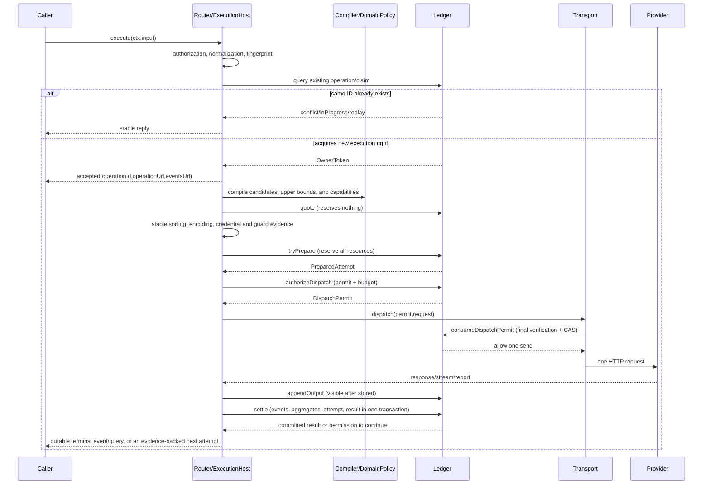

Version: V0.7. For the Go server execution host and network protocol, see [Architecture](01-ARCHITECTURE.md)/[API](08-API-AND-EVENTS.md); the algorithm steps in this chapter apply to the server internals, not to browser calling code.

# Full request path and transaction algorithms

Types are in [contracts.go](contracts.go), tables in [Storage Design](02-STORAGE.md). Each function below corresponds to a specific source file; time is injected into the Ledger writer via Clock, and networking exists only in the Go Transport. Operation results are interpreted by result_resolver.go inside the result transaction; the application layer does not infer terminal states on its own.

## 1. Go server submission and execution sequence



## 2. Inbound, identity, and claim

`Router.Submit` validates the ctx produced by AuthProvider and does not accept self-granted namespaces from the request body. DomainPolicy.normalize preserves string content with side effects, sorts object keys, preserves array order, and rejects invalid JSON/non-finite numbers, duplicate keys, and undefined fields; `fingerprint = SHA256('ant:semantic:v2\n' + canonicalJSON)`. v2 (frozen in the T1 rework): the digest document explicitly includes `capabilityProfile` — model capabilities that change business output must not rely on the convention of "the caller stuffing them into the payload"; different profiles necessarily produce different digests, and a judgment of semantic equivalence between two profiles can only be made by DomainPolicy's explicit normalization rules. v1 was never published with any persisted operation, so v1→v2 carries no replay-compatibility burden for old records; from now on, any change to digest inputs must bump the version and register the mapping in this section.

The digest includes domain, poolId, the full normalized business content, required affinity, and output constraints (AI maxOutputTokens/model capabilities/temperature; email body/recipients/attachment hashes). deadline, maxAttempts, preferred, allowMetered, and trace are first-operation policies; once stored, resubmission with the same ID cannot modify them. The Unicode of business content and email local-parts is never rewritten arbitrarily; email domain normalization is defined explicitly by the email policy.

Authorize first and look up an existing operation by identity, then compare digests to return conflict/inProgress/replay; this path is unaffected by changes to the current candidate configuration. Only new operations need the base-configuration availability check, preventing old terminal-state replays from being misjudged as InvalidConfig after an account is disabled. Under races, the final decision is still made by the claim transaction.

```text
claim(ctx,input,fingerprint,runtimeId):
  BEGIN IMMEDIATE
  assert principal grants namespace + execute for business request
  # internal system_probe requires manage and trusted internal context, never public execute payload
  existing = operations[key]
  if existing:
    if fingerprint != existing.fingerprint: return conflict
    if state != running: return replay(storedResult)
    if lease expired: sweepThisOperation(); return stored state
    return inProgress(view)
  assert authorized poolId exists in namespace, valid current config, restore_guard == 0
  assert deadline > now, 1 <= maxAttempts <= runtime.maxAttempts
  insert running operation(ownerId=UUID,generation=1,lease=now+leaseMs,
    fixed strategy, permitsIssued=0, cancel=null)
  COMMIT; return owned token
```

At this point there is no attempt, reservation, or send right yet. After ExecutionHost registers the task into the active map and starts lease renewal, execute returns accepted; if host takeover fails, completeWithoutAttempt atomically forms ExecutionInterrupted. If the claim reply is lost, query with the original ID instead of creating a new one.

## 3. Compilation, quote, sorting, and prepare

`Compiler.buildCandidates(request,activeConfig)` builds candidates by domain/capability/affinity, derives per-dimension upper bounds from verified BoundEvidence, and binds resourceRefs and rule versions. No candidates/insufficient required evidence forms a diagnostic rather than a fake default; when the operation already exists, a stable failure is saved via completeWithoutAttempt.

quote obtains a consistent snapshot and computes available quantities per [Resource Algorithms](04-RESOURCE-ALGORITHMS.md) without reserving. The default sort tuple is `[member.priority, offerId]`; smaller priority values come first. Cost is a diagnostic and allowMetered is a hard gate; neither may sort ahead of the user's order.

Before permitting, the Router completes encoding, credential resolution, and the latest guard evidence gathering as needed; provider keys exist only in the Transport's transient request context. Encoding/evidence and binding versions are fixed; if they cannot be satisfied, the candidate is rejected with no network business side effects.

```text
tryPrepare(owner,candidate,guards,requestDigest):
  BEGIN IMMEDIATE
  read operation; assert running, owner/generation match, lease > now
  if cancelled/deadline/budget: resolve terminal from durable facts; return terminal
  assert no prepared/executing attempt
  read current pool/member/offer; assert same poolVersion, enabled and authorized
  read current account/binding/credential policy, holds and trusted guard revisions
  assert enabled, no revoked credential, spend policy not weaker, guard valid
  assert candidate plan compatible with current config and evidence not expired
  read all resource states in sorted resourceId/windowKey order
  compute allocation: AND constraints + verified pool waterfall + occupancy
  if any rule denies: insert bounded rejected decision; return blocked, no resource delta
  validate ResourceChangePlan, insert fixed ExecutionPlan and prepared Attempt(requestDigest,guardRefs)
  insert all ReservationItems, reserve events, update all resource versions
  insert selected DecisionRecord and command receipt
  COMMIT; return PreparedAttempt
```

quote succeeding while prepare fails is normal; the Router records the race reason and tries the next already-legal candidate; planning rounds default to at most 3, bounded simultaneously by the overall deadline. If all candidates are blocked, AdmissionBlocked completes without waiting for Retry-After or capacity recovery. Database short-transaction retries and candidate planning rounds are not the same as outbound call attempt counts.

## 4. authorize and the final send

The authorizeDispatch transaction re-checks owner, cancellation, deadline, granted budget, current enabled/credentials/spend/holds/guards, metering compatibility, and windows. When prepared crosses a reset, the old counting reservation is atomically released and migrated to the current window; if any new resource is insufficient, the whole permit is rejected — partial migrations must never be left in the database.

On success: occupancy resources get `reserved -= q; active += q`, counting reservations unchanged; attempt→executing; insert one granted permit, `permitsIssued += 1`. The permit validity takes the minimum of operation deadline/lease/guard expiresAt, bound to runtimeId, generation, credentialRevision, controlVersion, and requestDigest.

Transport.prepare returns, before permitting, a PreparedHTTPRequest that exposes no secrets; the digest binds method, endpoint, non-secret headers, and body; bytes are copied to prevent later modification by the caller. dispatch verifies that the handle and the permit's requestDigest/credential version match. Transport rejects permit objects not produced within the current runtime (private nonce/handle table and runtime binding); it marks them used in the private handle table with mutex/atomic first, then asks the Ledger writer for final consumption. consumeDispatchPermit checks in the same transaction:

1. operation running, same owner/generation, valid lease, not cancelled, deadline not reached.
2. attempt executing, permit granted, same runtime, credentialRevision not revoked.
3. The current poolVersion and member/offer still allow it; account/binding enabled, spend and holds still allow it; guard revision/expiry valid.
4. The original allocation is still legitimate; the counting window has not changed, and current capacity and other consumption do not invalidate the admission basis of the existing reservation.
5. CAS `permit.status='granted' → 'consumed'`, succeeding only once. Any failure must reject the send; a permit that can be proven unconsumed may be revoked.

Immediately after the successful reply, invoke the Go-controlled HTTP send entry (standard-library hidden-replay guardrails are covered in the host and adapter design); the credential audience must match the preset endpoint; 3xx is handled as a response, no redirect following. After this point there is no re-gathering evidence, re-tokenizing, switching bindings, or automatic retries.

consume reply lost: it is already marked used locally, so no send and no re-consumption; conservative convergence. Pausing before final verification guarantees zero sends; pausing after verification but before writing to the socket still leaves one late-send possibility, sweeping does not take over resending, and the unknown occupancy is retained. This is the real boundary without provider fencing.

## 5. Report projection and settle

Adapter.decode produces the business outcome, per-dimension actual/chargedAt, providerRequestId, and external ending evidence; DomainPolicy.classify verifies against the stored plan and never directly trusts provider error strings or the Adapter's "retryable" boolean. Representable usage uses `Actual *Units`; exact non-negative decimal usage already normalized to plan units but greater than `MaxInt64` uses the optional `ActualOutOfRangeDecimal`; the two are mutually exclusive. It must be canonical decimal and strictly greater than `9223372036854775807`, and enters the report summary and `attempts.report_json` with `ExecutionReport`; the Adapter must preserve the original decimal fact before converting to int64/float64 — once precision is lost, it must not fabricate a recovery. Response bodies, credentials, and prompts must never be logged. Old report JSON without this field still decodes as the normal zero value.

```text
settle(owner,report,allowContinue):
  BEGIN IMMEDIATE
  check receipt settle/attemptId: same hash replay, conflict append evidence only
  read operation/attempt/plan/reservations and sorted resource states
  if terminal or owner no longer valid: append late evidence; require reconcile, no overwrite
  project each metric from stored plan:
    known int64 actual => actual; exact out-of-range actual => preserve report value,
      release reservation, emit zero committed delta, set resource hold, mark review
    absent but certified bound => conservative bound
    uncertain charge window => create attribution encumbrance + scoped hold
    occupancy => ended proof releases; otherwise active -> uncertain, retain slot
  release counter reservations, append consumption events, update totals
  record overrun if representable actual > reserved (still accept facts), block affected scope
  if actual is outside int64: do not fabricate committed units; mark result unknown/
    UnknownOutcome with accounting/actual_out_of_range and exact unrepresentableMetrics;
    set resource outcome basis=unrepresentable and consumed=null; never continue
  persist attempt terminal/report and cancel/current budget facts
  if known safe failure AND policy whitelist AND allowContinue AND no cancel/
     deadline/budget/visibleOutput/unknown/hold prohibition:
    operation stays running, no active attempt; return continue
  else resolveResult(all durable facts) and persist terminal result
  insert receipt + audit/decision refs; COMMIT
```

When a next attempt is needed, the failed attempt is already settled and its consumption is not refunded; the Router returns to candidate preparation, each time with a new permit. unknown, visible output, cancellation, and any prohibiting conditions do not continue. Full business success may still carry conservative counting or unconfirmed occupancy; the terminal state and resource state are independent.

## 6. Result resolution and completion without outbound calls

result_resolver.go takes as input all persisted reports, current cancellation, permits, budget/deadline, and blocking facts. Order: replay of an existing terminal state; confirmed success; termination required and externally unknown; effective cancellation with all externally known ended/not executed; failure classification; otherwise continue.

Failure classification follows DESIGN: required affinity, deadline, budget, ExecutionInterrupted, ordinary AdmissionBlocked, DomainFailure. completeWithoutAttempt with no active attempt uses the same resolver; owner lost after claim with no permit granted is `ExecutionInterrupted / owner_lease_expired_before_dispatch`. Holding a send permit while unable to confirm non-delivery cannot use this "no execution" reason.

## 7. Cancellation, sweeping, and late reports

requestCancel writes the cancellation time point and audit; prepared can release and become cancelled in the same transaction. executing only writes intent; after ExecutionHost receives it, it cancels the local I/O context and converges based on the actual report or unknown. A fully meterable success report takes precedence over cancellation semantics; if accounting facts fall outside int64 representability, the accounting review's unknown takes precedence over business success and cancellation. Cancelling an already-terminal operation is alreadyTerminal. Cancellation from another process is conveyed via bounded control-read batches, not via the in-process active map.

sweep processes at most 100 per batch, competing for renewal/settlement via conditional UPDATEs: claim with no attempt→complete with the unified result; prepared→release unsent reservations; executing→conservative unknown based on upper bounds/occupancy; increment generation/revoke unconsumed permits, and the old owner no longer has write or send eligibility. Lease expiry is not external ending evidence.

Late results and manual verification are appended uniformly to reconciliation; adjustments use Adjustment for the delta from the original conservative figure to the true figure and never decrement the monotonic committed watermark; ending evidence releases the corresponding encumbrance. The original unknown terminal state is not overwritten; queries show both the later confirmation and the current accounting, and the system never automatically resends because of verification.

## 8. Resource pool planning and current admission

Execution input must specify an authorized poolId; it is included in semanticFingerprint. The existing claim/prepare/permit/settlement algorithms are reused, with candidate sources changed to the current pool's enabled members and their offers; domain/profile/required affinity/security conditions are hard filters, sorted by member.priority, offerId. Cost is diagnostic only; the spend policy is a hard gate. Full rules in [Resource Pool Design](07-POOLS-AND-CONFIG.md).

ExecutionPlan gains poolId/poolVersion/offerId/memberPriority; tryPrepare, authorizeDispatch, and consumeDispatchPermit re-check pool and member version/enabled/permissions in the same transaction. Calls already consumed before a version change settle under the old plan; unsent ones are revoked based on reliable unsent facts and then replanned within limits. Each attempt's selection and historical order enter the DecisionRecord. HTTP reception/cancellation and SSE only call application ports and never perform routing.

## 9. AbortBeforeDispatch transaction matrix (K3, protocol frozen)

This section is the authoritative transaction definition of `Ledger.AbortBeforeDispatch`. Convergence after a pre-send rejection no longer depends on per-path custom logic; the implementation lives in T2.2 (the `server/internal/ledger` command layer), and the pure decision table has landed in `server/internal/ledger/abort.go` (`DecideAbort`). Runtime and fault verification belong to T2.2; this batch must not be marked as passed.

Trigger conditions: the Router discovers before `consume` that poolVersion/admission/cancellation/guards no longer allow sending, or a prepared attempt is cancelled/swept. The entry reads `(attempt.phase, permit.status, generation)` inside a Ledger writer transaction and competes for the same state guard as the `ConsumeDispatchPermit` CAS and `sweep`; the loser gets a conflict conclusion and must not apply partial effects.

| attempt.phase | permit.status | Evidence | Atomic handling |
|---|---|---|---|
| prepared | none (never authorized) | none | attempt→terminal(not_executed); release all reservations (counting reserved-=q, occupancy reserved-=q); if cancellation intent exists, the result is cancelled per the unified resolver, otherwise replanning is allowed |
| executing | granted (transaction CAS proves not yet consumed) | none | permit→revoked; attempt→terminal(not_executed); release reservations with no external execution yet (permit never consumed ⇒ Transport cannot have sent); `permitsIssued` is not rolled back (granted permit budget retained); replanning allowed |
| executing | consumed | Reliable unsent proof from the controlled Transport (this process's handle state proves the socket write never started) | After verifying the proof shares the same origin as the permit/attempt records, settle per resource as not_executed; never trust call arguments alone; replanning allowed |
| executing | consumed | No reliable unsent/ending evidence | attempt→terminal(unknown); counting conservatively committed+=bound per the verified upper bound; occupancy active→uncertain with an encumbrance opened; cross-window attribution isolation per §5 resource semantics; **automatic switching or resending is forbidden** |

Supplementary rules:

1. Cancellation of a prepared attempt also goes through this transaction to close the attempt; setting only the Operation to a terminal state while leaving a prepared attempt behind is a protocol violation (the single-active-attempt index would block the next prepare).
2. `external_ended` evidence is not an abort input: calls with a confirmed ending go through normal `settle`, and `DecideAbort` returns a hard error for that combination.
3. Race with consume: if consume's CAS (granted→consumed) commits first, abort reads consumed — handle per the consumed row in the table above (execution-free settlement is allowed only with unsent proof); if abort commits first, consume reads revoked/attempt already terminal and the send is rejected.
4. Race with sweep: sweep's convergence for the same attempt must pass through the same `(phase,status,generation)` guard; whichever side loses the race is a no-op, and double writes are forbidden.
5. Budget: no abort path refunds `permitsIssued`; revoking a granted-but-unconsumed permit only closes the permit and does not decrease the granted permit count.
6. Each abort writes the receipt (idempotency key `abort/<attemptId>` + input hash), events, resource aggregates, and the attempt terminal state in the same transaction; a lost reply can safely replay the same conclusion.

Acceptance ownership: T1 delivers this matrix, the port, and decidable-state test cases (`abort.go` unit tests cover every row of the table above plus illegal combinations); T2.2 implements the full transaction and validates against the K3 acceptance lines the network counting/resource set/next prepare for reorder after prepare, reorder after authorize, consume reply lost, crash after consume, and prepared cancellation.
