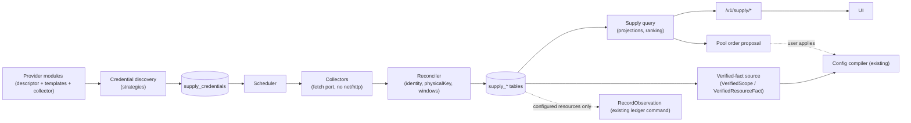

# Supply engine: what you hold, what it serves, what's left

Version: V0.2.1, 2026-10-08, rulings R1–R8 adopted (V0.2 + [consolidated review](../REVIEW-CONSOLIDATED-2026-10-08.md)). Status: **ruled; implementation by phase (§6).**
Basis: [Architecture](01-ARCHITECTURE.md), [Storage](02-STORAGE.md),
[Resource algorithms](04-RESOURCE-ALGORITHMS.md), [Runtime and adapters](05-RUNTIME-AND-ADAPTERS.md),
[Pools and config](07-POOLS-AND-CONFIG.md) (Q1 v3, frozen), [QUOTA](../QUOTA.md).
Answers [ENG-FINDINGS](../ENG-FINDINGS-2026-10-08.md) ENG-02/ENG-04 and every finding of
[REVIEW-DESIGN-11](../REVIEW-DESIGN-11-SUPPLY-ENGINE.md); changelog in §9, review verdicts in
[REVIEW-RESPONSE](../REVIEW-RESPONSE-2026-10-08.md).

This design replaces `internal/quota`. The provider research in that package is kept: endpoints,
sign-in ways, response shapes and their fixture tests. The structure is not.

## 1. Why the current quota package can't carry the router

`internal/quota` grew one provider at a time. Each provider is a set of functions that return an
`Account`, a display blob that mixes six different things:

| Mixed into `Account` | What it really is |
|---|---|
| `Way`, `Source`, `Values` | a **credential**: how Ant authenticates, and where the secret lives |
| `User`, `Identity`, `Keys` | the provider's **account**: one identity, possibly reached through several credentials |
| `Plan`, `Kind`, `RenewsAt`, `EndsAt`, `AutoRenew` | a **package**: what was bought or granted, with its own life |
| `Windows`, `Balances`, `Groups` | **resources** (meters) with **readings**: limit, used, left, window, reset |
| `Models` | **offers**: which models a credential can call, at which endpoint |
| `Message`, `Status`, `Link` | presentation and health |

The consequences:
- Nothing is persisted except credentials, in plaintext (`accounts.json`, ENG-06). No reading
  history, so no burn rate or forecast; a restart forgets everything.
- Rules ("weekly, Monday 00:00", "150 a day") are English strings and hand-written `time.Date`
  arithmetic, while `domain.WindowRule` and `resources.WindowAt` already model them.
- Models hang off whole accounts. The routing question is "for model M, which (credential,
  endpoint) can serve it, drawing on which meters, with how much left?" Today the browser
  re-derives that (`routes()` in `webui/static/app.js`).
- Each provider re-implements discovery: 18 `discover*` functions (17 free + 1 method), plus
  `Way.Discover` closures. Ways are code, not data.
- **A provider is modelled twice** (ENG-02): `quota.Provider` for observation and
  `domain.ProviderDescriptor` + `providers/catalog` for execution, with no shared identity,
  credential or fact model.
- None of it reaches the engine the router is built on (`bindings`, `resources`,
  `resource_offers`, pools, ledger), nor the **verified-fact port that already exists for exactly
  this purpose**: `domain.VerifiedScope` / `domain.VerifiedResourceFact`, resolved by the config
  compiler through `config.ProviderCatalog.ResolveScopeFact` / `ResolveDimensionalFact`, today
  "loaded from controlled local/test snapshots; real instances come from the verification port"
  (`domain/planning.go`). V0.1 missed this port; V0.2 is built on it.

## 2. The model

```text
provider ─< credential >─ account ─< package ─< resource ─< reading
                 │                               │
                 └──< access path (endpoint, protocol) ─< offer >── model
                                                     │
                                                     └─ draws on ─> resource(s)
```

- A **provider** module is reached through **credentials**; a credential authenticates as one
  provider **account** (the provider's own identity).
- An account holds **packages** (plan, prepaid balance, free grant, credit pack); a package has
  **resources** (meters with metric, unit, window, scope); resources get **readings** over time.
- A credential plus an endpoint is an **access path**; it serves **models** through **offers**, and
  each offer names every resource a call through it draws on.

The table "provider – resource – model or credit" is `offer ⋈ resource ⋈ latest reading`, by model.

### 2.1 Three stores, one writer each (resolves D11-02)

V0.1 wrote supply data into `accounts`, `resources`, `resource_offers` and `observations`. That is
wrong on evidence, not just on style:

- Configuration activation **already owns** `accounts`, `bindings`, `resources`, `resource_offers`,
  `resource_pools`, `pool_members` and the initial `resource_states`
  (`store/sqlite/config_projection.go`), and it **disables every `accounts`/`bindings`/
  `resource_offers` row the active config does not name** (`disableMissing`). A second writer's rows
  would be silently disabled at the next activation.
- `observations` is the **ledger's admission input**, not a reading log: it is keyed to a
  `resource_states` window (FK), carries the committed watermark and adjustment version at sampling
  time, stores only `remaining_units ≥ 0`, and is written only by the ledger command
  `AdminService.RecordObservation` (`POST /v1/resources/{id}/observations`, configure permission).
  A provider's limit/used/window bounds have no column there, and a resource that is observed but
  not configured has no `resources` row to reference.

So V0.2 has three stores with exactly one writer each:

| Store | Tables | Sole writer |
|---|---|---|
| **Supply** (observed, provider-verified facts) | `supply_*` (§2.4) | supply engine (reconciler) |
| **Executable configuration** | `accounts`, `bindings`, `resources`, `resource_offers`, pools | config activation (unchanged) |
| **Ledger** | `resource_states` counters, `observations`, `resource_events`, reservations… | ledger commands (unchanged) |

The two bridges are explicit and both already exist as ports:

1. **Supply → configuration (resolution, not copying).** The supply store is a *source of verified
   facts*: a catalog source projects each `supply_accounts` row as a `VerifiedScope` and each
   `supply_resources` row as a `VerifiedResourceFact`. The config compiler resolves resources
   against them exactly as Q1 v3 prescribes (by `factId`, or by metric/unit/canonical window; 0 →
   `factUnresolved`, >1 → `ambiguousFact`; dimensions must match; `configuredCapacity ≤
   capacityBound`). Activation then writes `resources` as it always has. The supply engine never
   writes a configuration table; activation never writes `supply_*`.
2. **Supply → ledger (admission).** For a resource that is configured, the scheduler may submit its
   latest reading as an `ObservationEvidence` through `RecordObservation`, which binds it to the
   window, watermark and adjustment version and replays idempotently. Never a direct insert.

### 2.2 Mapping onto Q1 v3 (design 07 §1, frozen — not amended here)

| Q1 v3 term | Supply engine source |
|---|---|
| `VerifiedScope{kind: account}` | `supply_accounts` row (provider + provider-reported identity) |
| `VerifiedScope{kind: shared, aliases}` | **out of scope for V1** (§2.6) |
| `VerifiedResourceFact.physicalKey` | `supply_resources.physical_key` = hash(provider, account identity, package template, resource template, scope), derived by the server from global inputs (no namespace), so the same physical capacity has the same key everywhere; stored unique **per namespace** (each namespace keeps its own observation, and none learns that another holds the account). Activation's one-ledger rule applies to the key's value. |
| resource identity | `supply_resources.resource_id` (stable across re-reads) |
| metric, unit, quantumExp, currency, metered | resource template in the provider module |
| semanticsRef / semanticsRevision | resource template (§2.3), registered in the provider descriptor |
| canonical window (kind/period/tz/anchor/duration) | resource template `domain.WindowRule`; a provider-reported reset is evidence, not identity |
| `factId` of one **snapshot** | `<resource_id>@<reading_id>` (§2.2.1) |
| capacityBound | that snapshot's `limit`; for a balance (no limit), its `remaining` |
| initialRemaining | that snapshot's `remaining` |
| evidence | that `supply_readings` row + its `collector_runs` row (source, time, outcome) |

#### 2.2.1 Facts are immutable snapshots (R3, corrected in V0.2.1)

V0.2 proposed "`capacityBound` taken at resolution and re-checked at activation". The code rules
that out, and it equally rules out the consolidated review's added condition ("fail the next
activation only if `capacityBound` shrinks below `configuredCapacity`"):

- The compiler requires evidence quantities to **equal** the fact, not merely bound it
  (`checkEvidenceQuantity` → `evidenceConflictsVerifiedFact`, `config/compile.go`; its comment:
  "Evidence quantities describe the fixed verified snapshot").
- `ActivateDraft` **recompiles against the catalog inside the write transaction**
  (`application/config_service.go`, `validateForNamespace` in the `SubmitWrite` closure) and seeds
  the ledger from the fact (`Committed = capacity − InitialRemaining`).

So against a live "latest reading" source, *any* change between validation and activation — a
window ticking, a balance spent, even a top-up — fails activation. For balances the review's
condition would trip on ordinary spending. Q1 v3 needs no amendment if facts are what it already
says they are, fixed snapshots:

1. Each `supply_readings` row is an immutable fact snapshot, `factId = <resource_id>@<reading_id>`.
   `physicalKey` is identical across snapshots of one resource (identity), so the clone rule and
   "one ledger per physical capacity" are unaffected.
2. A draft created from supply ("adopt this resource", pool proposal) always writes the **explicit
   snapshot `factId`** and evidence stamped from that same snapshot. Validation and the in-transaction
   recompile at activation resolve the same immutable row, so activation is reproducible.
   Dimensional resolution (no `factId`) resolves to the latest snapshot and is for hand-written
   drafts only.
3. Freshness after activation flows through the ledger, not through re-activation: the scheduler
   submits newer readings of configured resources via `RecordObservation` (§2.1 bridge 2), which
   is watermark-checked and already designed for exactly this.
4. Re-basing a configuration on a newer snapshot is an explicit draft action ("update to latest
   reading"), shown as a diff, never automatic.
5. Because snapshot rows are append-only, the fact source may serve the in-transaction recompile
   from a separate read connection (or a preloaded immutable index) without touching the writer.

What remains for the user to confirm (R3) is only that this is the intended reading of Q1 v3.

### 2.3 Resource semantics: reuse, don't invent (resolves D11-04, D11-05)

V0.1 added a `role` enum (`allowance`, `balance`, `rate`, `concurrency`). The engine already has
the concept: `domain.RegisteredSemantics{ResourceKind counter|occupancy, CommercialRole
limit|entitlement}`, registered per provider and the only trusted source of execution type. Each
resource template therefore names a registered `semanticsRef`; nothing new is stored per resource.

| V0.1 role | Registered semantics | Who produces readings |
|---|---|---|
| allowance (windowed plan quota) | counter · limit | collector |
| balance / credits / free grant | counter · entitlement | collector |
| concurrency | occupancy | **execution only** (ledger active units, dispatch permits) |
| rate (RPM/TPM) | counter · limit, short rolling window | **execution only** (429s, provider rate headers seen by transport) |

Collectors can only emit readings for templates whose semantics are `counter`; the reconciler
rejects a collector reading against an `occupancy` template or a template marked
`executionOwned`. A provider-reported rate header is an execution outcome: transport may record it
on the attempt; it never becomes a supply reading.

### 2.4 Schema sketch (resolves D11-03, D11-04, D11-08)

Every table carries `namespace`; secrets live only in the existing namespace-owned
`secret_records`/`secret_refs`. Tables land with their first use (phase in brackets).

Phase 1 is implemented; its authoritative schema is
[`server/migrations/006_supply_store.sql`](../../server/migrations/006_supply_store.sql), not a copy
here. Beyond this section's original sketch it adds, by review: the composite secret foreign key
`(namespace, secret_ref)` (a credential can only use its own namespace's secret, via a unique index
on `secret_refs`), `UNIQUE(namespace, physical_key)`, `UNIQUE(namespace, account_id, template_ref)`
on packages, a reading→run foreign key, a run outcome/finish pairing CHECK and a window-order
CHECK. Write errors are typed (`store.ErrSupplyIdentityConflict`, `ErrSupplyMissingReference`,
`ErrSupplyReadingOutOfOrder`, `ErrCollectorRunNotOpen`).

```sql
-- [phase 3]
CREATE TABLE models (model_id TEXT PRIMARY KEY, vendor TEXT NOT NULL, family TEXT NOT NULL,
  media TEXT NOT NULL, context_tokens INTEGER, definition_json TEXT NOT NULL CHECK(json_valid(definition_json))) STRICT;
CREATE TABLE model_aliases (namespace TEXT NOT NULL DEFAULT '',   -- '' = global catalog/rule alias
  provider_id TEXT NOT NULL, upstream_id TEXT NOT NULL,
  model_id TEXT NOT NULL REFERENCES models(model_id),
  source TEXT NOT NULL CHECK(source IN('catalog','rule','user')),
  CHECK((source = 'user') = (namespace <> '')),            -- user overrides are always namespaced
  PRIMARY KEY(namespace, provider_id, upstream_id)) STRICT;
CREATE TABLE supply_offers (
  namespace TEXT NOT NULL, offer_id TEXT NOT NULL, credential_id TEXT NOT NULL,
  endpoint TEXT NOT NULL, protocol TEXT NOT NULL,           -- openai-chat, anthropic-messages, responses, gemini, web-only
  upstream_model TEXT NOT NULL, model_id TEXT REFERENCES models(model_id),
  draws_json TEXT NOT NULL CHECK(json_valid(draws_json)),   -- [{resource_id, per, multiplier}]
  verified_at INTEGER NOT NULL, PRIMARY KEY(namespace, offer_id)
) STRICT;
```

`models` and catalog/rule aliases are global catalog data; a user override is a namespaced
`model_aliases` row that shadows the global one for that namespace only.
History needs no fold (D11-08): readings are appended only on change, freshness comes from
`collector_runs`, and burn rate/forecast read `supply_readings` directly. A month of 5-minute
polling on 50 resources whose value changes on every poll is ~430k rows; that ceiling is
acceptable for SQLite and is revisited only if measured otherwise.

### 2.5 Examples (rows, abridged)

| provider | package (kind, basis) | resource (metric · unit · window · scope) | semantics | offers drawing on it |
|---|---|---|---|---|
| zai | Coding Plan Pro (subscription, observed) | prompts · count · rolling 5h · all | counter·limit | glm-5.3, glm-5.3-air via `api.z.ai/api/coding/paas/v4` |
| zai | same | prompts · count · week, anchored · all | counter·limit | same offers |
| aliyun | Free quota (free_grant, observed) | tokens · token · lifetime, ends 2026-11-19 · model `kimi-k3` | counter·entitlement | kimi-k3 via DashScope |
| aliyun | Free quota (free_grant, observed) | images · image · lifetime · model `qwen-image-3.0` | counter·entitlement | qwen-image-3.0 |
| deepseek | Balance (prepaid, observed) | money · CNY (quantum −2) · lifetime · all | counter·entitlement | deepseek-v4, deepseek-v4-pro (price per Mtok) |
| copilot | Pro (subscription, observed) | premium requests · request · month · all | counter·limit | gpt-5.5 (×1), claude-sonnet-5-5 (×1), opus (×10) |
| copilot | same | requests · request · rolling 1 min · all | counter·limit, **execution-owned** | same offers; never collected |
| kling | Credits (credit_pack, observed) | credits · credit · lifetime, each lot ends · all | counter·entitlement | none callable: `web-only` |
| figma | Starter (free_grant, **declared**) | ai-credits · credit · month and day · all | counter·limit | none: no collector, no reading |

One resource can back many offers, and one offer can draw on several resources — the many-to-many
of `offer_resources`, mirrored here by `draws_json` until the offer is adopted into configuration.

### 2.6 Out of scope for V1: shared, family and team plans (resolves D11-06)

Two seats on one family plan, or one organization pool billed to many keys, are not represented.
Guard: a shared billing identity (`VerifiedScope{kind: shared}`) may only ever come from a
provider-reported fact (an org/team id in the collector's inventory). It is **never inferred**
from coincident reset times, equal limits or similar names. Two credentials merge into one account
only when the collector reports the same provider identity.

## 3. The engine



### 3.1 One provider module owns its semantics (proposal for the ENG-02 ruling, R1)

Each provider is one Go package under `internal/providers/<id>` that owns everything about it:

- the existing execution side, when it has one: `domain.ProviderDescriptor` (semantics, profiles,
  schemas, entitlement facts) and its adapter, as `providers/deepseek` does today;
- its supply side: credential sources, package and resource templates (each naming a registered
  `semanticsRef`), endpoint templates, the origins it may contact, and its collector.

`providers/catalog` aggregates modules for both the config compiler and the supply engine.
`internal/quota` does not survive as a host; its parsers move into the modules.

```go
type Supply struct {
    Credentials []CredentialSource // ways to get a credential, easiest first: data, not functions
    Packages    []PackageTemplate  // resources with metric, unit, domain.WindowRule, scope, semanticsRef
    Endpoints   []EndpointTemplate // base URL + protocol per credential kind
    Origins     []string           // every https origin the collector may contact (allowlist)
    Collector   Collector          // nil: declared-only package (Figma, Stitch)
}
type CredentialSource struct {
    Strategy string         // file-json, keychain, env, browser, cli-config, device-login, console-login, paste, form
    Params   map[string]any // path + JSON pointer, keychain service, env names, cookie domain + marker, OAuth client…
    Kind     CredentialKind
}
```

Strategies are implemented once (`internal/supply/discover`): `file-json` (Codex, Gemini CLI,
Copilot `apps.json`, `bl` config), `keychain` (Claude Code, Copilot CLI), `env`, `browser`
(Chromium family, Firefox, Safari — via the read-only `quota/cookiestore` helper, which moves with
it), `cli-config` (aliyun, ve, gh), `device-login` (Volcengine), `console-login` (Bailian),
`paste`, `form`.

### 3.2 Collectors and the dependency boundary (resolves D11-01)

```go
// Fetch is the only network access a collector has. It is implemented in
// internal/transport and enforces the module's Origins allowlist, HTTPS,
// no cross-origin redirects, response size and time bounds.
type Fetch func(ctx context.Context, r Request) (Response, error)

type Collector interface {
    // Inventory reads what the account holds now. Parse only: no storage,
    // no clock reads, no net/http import.
    Inventory(ctx context.Context, s Session, fetch Fetch) (Inventory, error)
}
type ModelLister interface { // optional
    Models(ctx context.Context, s Session, fetch Fetch) ([]UpstreamModel, error)
}
type Inventory struct {
    Identity string            // provider's own account id/email: merges credentials
    Packages []PackageReading  // template_ref + plan + dates
    Readings []ResourceReading // template resource ref (+ scope), limit/used/remaining, window bounds
}
```

This is Option A of ENG-01 for the new engine, using the pattern already proven by DeepSeek
balance (`application.DeepSeekBalanceFetcher` + `transport.NewHTTPClientWithAllowedEndpoints`).
Package layout and its `check-deps.py` edges:

| Package | May import | net/http | SQL |
|---|---|---|---|
| `providers/<id>` (descriptor, templates, collector) | domain, providers/catalog types | no | no |
| `supply` (reconciler, scheduler, query, discovery) | domain, store port, providers/catalog | no | no |
| `supply/discover` browser strategy → `cookiestore` | — | no | read-only foreign files (existing exemption) |
| `store/sqlite` (`supply_*` statements) | as today | no | yes |
| `transport` (`Fetch` implementation) | as today | yes | no |
| `api` (`/v1/supply/*`) | application, supply | yes | no |

The temporary `internal/quota` net/http exemption recorded on 2026-10-08 ends when phase 4 deletes
the package; no exemption is carried into `supply` or `providers/*`.

### 3.3 Reconciler

- **Identity.** Two credentials whose inventories report the same provider identity are one
  `supply_accounts` row (two Z.ai keys of one plan; Claude Code's Keychain sign-in and a pasted
  token). Replaces `mergeSame` and `hideFailedWays`.
- **Stable keys.** `package_id`, `resource_id`/`physical_key` and `offer_id` derive from
  (account, template, scope), so a re-read updates rows instead of creating them.
- **Windows.** A reading's bounds are checked against the template's `domain.WindowRule` with
  `resources.WindowAt`. A provider-reported reset wins (`reset_basis = reported`); a computed one is
  `computed`.
- **Semantics guard.** Readings for occupancy or execution-owned templates are rejected (§2.3).
- **Readings.** Append a `supply_readings` row only when (limit, used, remaining, window,
  reset basis) differs from the latest; every run is in `collector_runs`.
- **Reading order.** `observed_at` is **Ant's** clock when the read completed, never a
  provider-reported time (those go into window bounds and evidence), so it only moves backwards if
  the host clock does. A reading must be strictly newer than the latest for its resource; the store
  returns `ErrSupplyReadingOutOfOrder` otherwise (same millisecond, older, or a replay). The
  reconciler treats that as "skipped", not as a failure: the run finishes `ok` with the skip noted
  in `detail`, and the next run proceeds normally.
- **Size caps (engine-side, before any write).** `evidence_json` and `definition_json` ≤ 16 KiB
  (larger provider replies keep only the fields the parser used), `status_detail` and run `detail`
  ≤ 512 characters. The schema does not cap JSON, consistent with the rest of the store; the
  writer's command budget is not a size control.
- **Reads the scheduler needs** (added in phase 2 with their first consumer, not before): latest run
  per credential and capability (freshness, "checked, unchanged"), and `ListSupplyPackages`.
- **Models.** Upstream ids resolve through `model_aliases`; unknown ids get a `rule` alias by
  normalization (strip `vendor/`, case, date-suffix rules) or stay unresolved and are shown so.

### 3.4 Scheduler

- Cadence per credential and capability. Inventory: default 5 min; 1 min within 15 min of a
  reset; 30 min for balances. Declared-only packages are never polled. Models: 6 h. Verify: on
  change.
- Single-flight per credential, exponential backoff on errors, global in-flight cap (the DeepSeek
  balance path caps at 8; reuse that bound).
- The page never triggers provider calls directly. It reads projections; "Refresh" asks the
  scheduler to run now.

### 3.5 Supply query, ranking and the API

Projections are SQL over `supply_*`: **resources** (everything held, latest reading),
**models** (per canonical model: offers → access path → resources), **timeline** (resets,
renewals, expiries), **health** (credentials needing attention).

The API is `/v1/supply/*` behind the existing `AuthMiddleware`, namespace-scoped: `read` sees
projections; `configure` adds/removes credentials, applies a pool proposal and requests refresh.
Secrets are never returned. Today's `/api/*` LocalOnly surface is retired with `internal/quota`.

**Page transition (no phase may leave the page without a working path).** Until phase 4 the page
keeps reading `/api/*`; each view switches to `/v1/supply/*` only when that endpoint reaches parity
for it. `/v1` needs a session, and today's page needs no login. The existing path is the one-time
`-bootstrap-admin` token exchanged once at `POST /sessions` for a persistent browser session;
`-demo` mints a demo-namespace session automatically. Whether a loopback-only automatic session for
the local operator should replace the one-time token is a security posture choice: ruling R8.

**Ranking is a policy, not hard-coded UI.** Default order for a model's offers: (1) use-before-lost
(expiring grants, windows resetting soon with room); (2) subscription headroom; (3) prepaid,
cheapest first; (4) pay-as-you-go; (5) exhausted, never. The policy **proposes** pool order; per
design 07 the user's order is authoritative and the router never silently reorders. "Apply
suggested order" creates a configuration draft that changes `pool_members.priority`; it is
activated like any other draft.

### 3.6 Declared is never observed (resolves D11-07a)

`supply_packages.basis` is `observed` (a collector produced it) or `declared` (the user entered it;
no collector). A declared package has no `supply_readings` rows, ever: the reconciler refuses to
write readings for it and the API returns `remaining: null` with `basis: "declared"`. The page
renders declared values in a distinct style labelled "your entry", and the ranking policy places
declared-only resources after every observed resource. A declared value therefore cannot
masquerade as a balance, which is what sank the rejected inventory.

### 3.7 Web-only is never executable (resolves D11-07b)

Executability is decided by the existing server-side checks, not by the page: an offer whose
`protocol` is `web-only` (or any protocol without a registered adapter) cannot become a
`bindings`/`resource_offers` row, because the config compiler rejects bindings and offers on a
domain the provider type does not support (`cat.SupportsDomain`, `config/document.go`), and the
runtime filters candidates again with `pools.FilterEligible`
(`application/candidate_planner.go`). The pool proposal (§3.5) only lists offers whose protocol has
a registered adapter.

### 3.8 Credential renewal (V0.2 dropped V0.1's one-line "renewal done by the engine")

- **Found credentials are never renewed.** Another tool's refresh token is never spent: renewing it
  can sign that tool out (rule carried over from QUOTA.md). The engine reads the tool's current
  token on each run; when it has lapsed the credential is `signed_out` with "renew it in <tool>".
- **Ant-owned credentials** (`origin = added`, including Ant's own sign-ins and device logins) are
  renewed by the engine before the collector runs, single-flight per credential. A rotated secret is
  written as a **new revision** of the same `secret_ref` through the existing secret commands
  (`secret_records` is keyed by `(secret_ref, revision)`), in the same transaction as the
  `collector_runs` row that caused it; collectors never see or persist secrets.
- `verify` capability = one renewal (when Ant-owned) plus one cheap identity read; it runs when a
  credential is added or changed and sets `status`/`verified_at`. A renewal failure marks the
  credential `signed_out` and stops its schedule until the user acts.

### 3.9 Interfaces (binding constraint for every phase)

Rules, adopted from the consolidated review §4: interfaces belong to their **consumer**; an
interface exists only with a second real implementer or at a true layer edge; modules register
through a fail-fast registry (the `application/provider_registry.go` shape); files stay ≤500 lines.
Provider differences are **data** (`Supply`, templates); behavior is small interfaces.

| Interface | Defined in (consumer) | Implemented by | Why it qualifies |
|---|---|---|---|
| `Collector`, `ModelLister` | `providers/catalog` | each provider module | ~20 implementers |
| `Fetch` (func type) | `providers/catalog` | `transport` (prod), fixture servers (tests) | layer edge: network |
| `Discovery` per strategy | `supply/discover` | one per strategy (9) | many implementers |
| `FactSource` (snapshot facts by scope/factId/dimensions) | `providers/catalog` — it already aggregates facts for the compiler through `config.ProviderCatalog`; no second compiler-facing interface in `config` | fixture/snapshot facts (today's catalogs), supply store | two implementers |
| `store.SupplyWriterTx` / reader | `store` (capability type-asserted, like `AdminWriterTx`) | `store/sqlite` | layer edge: storage |
| `observationRecorder` (`RecordObservation`) | supply scheduler | `ledger/commands.AdminService` | layer edge: ledger; fake in tests |
| `SupplyQueryCommands`, `SupplyControlCommands` | `api` | application supply service | api's existing per-use-case pattern |
| clock | reuse `application.Clock` | runtime clock | existing |

`providers/catalog` today accepts a fact only from the source that owns its provider type
(`catalog.go`, `source.types[fact.ProviderTypeID]`). Supply facts span every provider type, so
`FactSource` is a separate, explicitly registered input of the catalog, not another
`config.ProviderCatalog`; a fact whose provider type no registered module owns is rejected.
Not added: `Reconciler`/`Scheduler` interfaces (one implementation each), a `Provider`
mega-interface, repository interfaces beyond the store capability pattern.

## 4. Mapping today's code

| Today | Becomes |
|---|---|
| `quota.Provider` / `Mode` | provider module `Supply` + `PackageTemplate` |
| `Mode.Rule` (string) | template resources with `domain.WindowRule` + `semanticsRef` (the sentence stays as help text) |
| `Way` | `CredentialSource` |
| `Connection` (+ `accounts.json`) | `supply_credentials`; added secrets in `secret_records` (encrypted); found secrets left where they live (`locator_json`) |
| `Account` | projection over account + packages + resources + latest readings |
| `Window` / `Balance` | resource + reading (balance: unit = currency or credit, `counter·entitlement`) |
| `Group` | package (or a resource scope) |
| `Account.Models` | `supply_offers` + `model_aliases` |
| `readX` functions | `Collector.Inventory` (parser kept, fetch injected) |
| `discoverX` functions, `Way.Discover` | strategy parameters |
| `Service.refresh`, `mergeSame`, `hideFailedWays` | scheduler + reconciler |
| `Local.fetch` / `readerClient` | `transport` `Fetch` with per-module origin allowlist |
| `modelCache` | `supply_offers.verified_at` |
| browser `routes()` | `models` projection + ranking policy (server) |

## 5. Secrets and the master key (resolves D11-07c)

The engine's secret mechanism today is a 32-byte, 0600 key file (`-secret-master-key-file`,
`-generate-secret-master-key`), required for every secret route; there is no Keychain storage.
V0.2 keeps that mechanism as the only one in phase 1. Storing the key in the macOS Keychain is a
later, optional *extension* (the Keychain holds the same 32 bytes instead of the file) and is not a
dependency of any phase.

Phase 1's `accounts.json` import:
- with a master key configured: each secret value goes to `secret_records`, the credential row
  gets its `secret_ref`, the readback is verified, and only then is the value removed from
  `accounts.json` (the file is rewritten without `values`; a `.bak` is not kept);
- without a master key: nothing is imported; credentials are listed with `status = needs_key` and
  the page offers to create the key file. **Plaintext is never written to `ant.db` as a fallback**,
  and `accounts.json` is left as it is (it already is plaintext; see ENG-06 R5).

## 6. Migration (each phase ships; the page keeps working)

| Phase | Delivers | Removes |
|---|---|---|
| 0. Preconditions | ENG-01 gate green (done 2026-10-08); ENG-03 supply-inventory retirement (`/v1/inventory`, `domain/supply`, table drop — ruled R7, done 2026-10-08, schema v5) | — |
| 1. Store | migration with the phase-1 `supply_*` tables; repositories in `store/sqlite`; `accounts.json` import (§5) | `accounts.json` writes |
| 2. Engine shell | discovery strategies, scheduler, reconciler; an adapter that wraps today's readers and converts `Account` → `Inventory`, so every provider works on day one | `Service.refresh`, `mergeSame`, `hideFailedWays` |
| 3. Models | `models`, `model_aliases`, `supply_offers`; curated `models.json`; `/v1/supply/models` with ranking | browser-side `routes()` |
| 4. Native modules | providers ported one by one into `providers/<id>` with `Collector` + `Fetch` (Z.ai, ChatGPT, Claude, Copilot, Bailian first); each moves only when it passes the same fixture tests its reader has today | `internal/quota`, `/api/*`, the quota net/http exemption |
| 5. Verified facts | the `FactSource` (snapshot facts, §2.2.1) behind `ResolveScopeFact`/`ResolveDimensionalFact`; adopt-from-supply drafts pin a snapshot `factId`; pool proposal → config draft; `RecordObservation` feed for configured resources | — |
| 6. History | burn rate, "lasts until", forecast on the timeline (reads `supply_readings`) | — |

Phase 2 progress (one commit per step): **1. discovery and scheduling — done 2026-10-08**
([evidence](../evidence/WORK/SUPPLY-ENGINE/README.md); `Service.refresh`'s read loop is gone, the
engine schedules and records reads; until the import step only found credentials are recorded);
2. reconciler + `Account` → `Inventory` (replaces `mergeSame`/`hideFailedWays`); 3. per-site
browser opt-in (R6); 4. page session on `/v1` (R8); 5. `accounts.json` import (§5).

Migration numbering and table count (`store/sqlite/migrate.go`, `expectedTableCount = 36` today):
if ENG-03 is confirmed, `005_drop_supply_inventory.sql` (36 → 35) precedes `006_supply_store.sql`
(+6 → 41), and phase 3's migration adds 3 (→ 44). If ENG-03 is deferred: 36 → 42 → 45. One batch
carries one coordinated plan; numbers are assigned when the batch starts, not here.

## 7. Decisions (made 2026-10-08, restated)

1. **Added secrets** are encrypted in `ant.db` (`secret_records`) — one mechanism with the
   execution engine; the master key per §5. Secrets other apps hold stay where they are; Ant
   stores only their locator.
2. **Models** have canonical ids from a curated `models.json` shipped with Ant, plus automatic rule
   aliases and user overrides.
3. **Web** stays embedded and vanilla until pool reordering needs drag-and-drop; then the React app
   of design 09.
4. **Web-only resources** (Kling, SeaArt, Suno, Figma…) are packages and resources with `web-only`
   access paths: shown, tracked and on the timeline, never executable (§3.7).

## 8. Rulings (made by the user 2026-10-08: every proposal below adopted as written)

| ID | Question | Proposal | Reviewer (consolidated §3) |
|---|---|---|---|
| R1 | ENG-02: who owns provider semantics? | One module per provider under `internal/providers/<id>`, execution + supply (§3.1); `internal/quota` retires in phase 4. Freeze on new providers until ruled. | accept |
| R2 | ENG-04: is the bridge "supply store as the source of Q1 v3 verified facts" (§2.1)? | Yes; activation stays the sole writer of configuration tables. | accept |
| R3 | Q1 v3 reading: facts are immutable snapshots; supply-made drafts pin a snapshot `factId`; freshness after activation goes through `RecordObservation` (§2.2.1) | Confirm. | accept, with a shrink-only re-check — **not adopted**, see §2.2.1 |
| R4 | Egress scope: read-only, credentialed usage/balance reads (shipped, user-directed) are product behavior; billable/execution calls stay gated by IN-01…04/G0–G1 | Keep; record in STATUS and correct the ENG-FINDINGS guard wording. | keep |
| R5 | Accept plaintext `accounts.json` until phase 1 lands? | Accept temporarily; phase 1 removes it. | accept |
| R6 | Everyday-browser cookie reading: automatic, or opt-in per site? | Opt-in per site, remembered in `supply_credentials` (`status = hidden` until enabled). | accept opt-in |
| R7 | ENG-03: drop `supply_inventory` data (one-way) | Drop. | accept |
| R8 | Page auth after the move to `/v1/supply/*` (§3.5) | Keep the existing one-time bootstrap token → persistent session; no new auto-session path. | not covered |

## 9. Changelog V0.1 → V0.2

| ID | Change |
|---|---|
| D11-01 | §3.2: collectors get an injected `Fetch` from `transport` with per-module origin allowlist; package/edge table; the quota exemption is temporary and ends in phase 4; the cookie store is the existing narrow `quota/cookiestore` exemption. |
| D11-02 | §2.1–2.2: three stores, one writer each; configuration activation **keeps** sole ownership of `resources` (the review proposed the opposite, which would change accepted activation code and a frozen design); the bridge is the existing Q1 v3 verified-fact port; Q1 v3 mapping table; tension listed as R3. |
| D11-03 | §2.4: every supply table carries `namespace`; secrets via namespace-owned `secret_records`; §3.5 permissions. |
| D11-04 | §2.3/§2.4: no `role` column; semantics are the existing `RegisteredSemantics`; `window_json`, `semantics_ref/revision`, `scope_json` stored per resource. |
| D11-05 | §2.3: occupancy and rate are execution-owned; the reconciler rejects collector readings for them. |
| D11-06 | §2.6: shared plans out of scope for V1; never inferred. |
| D11-07 | §3.6 `basis` declared/observed; §3.7 executability enforced by compiler + `FilterEligible`; §5 master key and no-plaintext import. |
| D11-08 | §2.1: V0.1's "collectors write `observations`" was wrong — that table is the ledger's admission input; readings go to the new append-only `supply_readings`. The review's fix (append-only trigger on `observations` + fold) is not adopted: it would alter accepted ledger schema and still put display history into the admission table. No fold; append on change. |
| D11-09 | §1: 18 `discover*` functions; §2.1 states which tables hold provenance and which are ledger aggregates; reuse vs new is explicit in §2.4. |
| D11-10 | §6: phase 0 folds in ENG-03; migration arithmetic for both outcomes. |
| own | §1/§3.1: V0.1 ignored `domain.ProviderDescriptor` and the verified-fact port; §2.1: V0.1 also wrote `accounts`/`resource_offers`, which activation's `disableMissing` would silently disable; §2.4: balances can be negative and money needs `quantum_exp`; §3.5: API moves under `/v1` and auth. |

### V0.2 → V0.2.1 (consolidated review)

| Item | Change |
|---|---|
| R3 | §2.2.1: facts are immutable reading snapshots; supply-made drafts pin a snapshot `factId`. Both V0.2's "re-check at activation" and the review's shrink-only condition are withdrawn: the compiler requires evidence to *equal* the fact and activation recompiles in-transaction, so any live change would fail activation (balances on every spend). |
| §4 doctrine | §3.9: rules and interface table adopted; `FactSource` placed in `providers/catalog` (not `config`), registered separately because supply facts span provider types; added `store.SupplyWriterTx` and `observationRecorder`, which the review's table missed. |
| Watch 1 | §2.4: user alias overrides are namespaced (`model_aliases.namespace`, CHECK). Table count unchanged. |
| Watch 5 | §3.5: page transition per view; R8 for `/v1` page auth. |
| Watch 6 | §3.8: renewal specified. V0.2 had dropped the V0.1 sentence entirely; found credentials are never renewed. |
