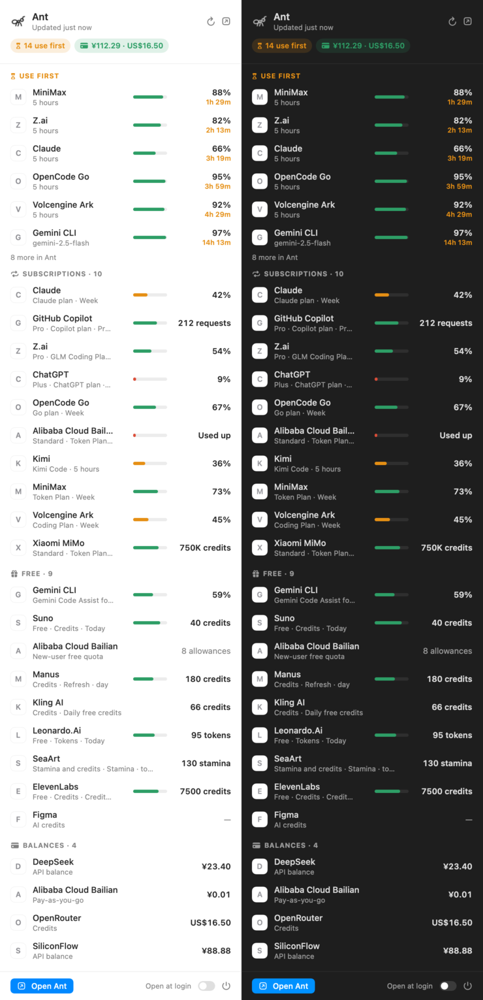

# Stage 1 — manage providers and resources smoothly

User direction (2026-10-08), verbatim: “stage 1: manage providers and resources smoothly. Although
there are too many different providers, products, resources in the world, you still should to make
sure you have reached this goal. make complex to simple, make chaotic to clear. everything should be
simple and clear.”

This file is the running record of what was checked against that bar and what changed.

## Pass 1 (2026-10-08): the page

**Found** (demo mode, desktop and 375 px):
1. The toolbar had ten controls in two rows: category tabs, search, three views, and four
   dropdowns. "Type" meant *media* in a dropdown and *payment kind* elsewhere; the Model dropdown
   repeated the search box and the Models view; "Group by" repeated the tabs.
2. Tab labels and section titles disagreed ("API balance"/"API balances", "Free"/"Free
   allowances").
3. Add account was a flat grid of 27 providers with no search and no sign of what was already
   connected; it grows with every provider.

**Changed** (`server/internal/webui/static`, −98/+46 lines):
- One toolbar row: category tabs · one search · sort · views. The search now also matches what an
  account makes (image, video…) and model ids, and narrows a card to the matching allowances, so
  the Type and Model dropdowns are gone. Cards are grouped by category, the same as the tabs; the
  Group dropdown is gone.
- One vocabulary: Subscriptions · API balances · Free allowances, in tabs, sections and the
  summary.
- Add account opens with a focused search (provider name or what it makes) and marks providers
  already connected.
- The browser opt-in (R6) is one sentence and one button inside the existing flow.

**Checked:** search for `image`, `video`, `glm-5.3`, `kimi-k3` and a miss; Add account search
`video` (6 providers) and `deep` (DeepSeek); no page overflow at 375 px (the tab strip scrolls);
four gates pass.

**Still to judge** (next passes): the Add flow's three steps (provider → way of paying → way of
reading) carry long paragraphs; the summary tile "Use before it's gone: 15" counts allowances
without saying so; card menus and the Timeline view were not reviewed yet.

## Ability: history and forecasts (2026-10-08)

**What the page now says.** A window that will be used up before it resets says so on its row:
"runs out in ~1d 18h at this pace", in warning colour. A balance shows a small 7-day trend line and
"≈ 18d left at 72.22 credits/day" (or "Nothing spent this week"). Rows that simply last say
nothing — lasting is the expected case, and saying it on every row was noise. When the pace uses an
allowance up first, its "Use before reset/expires" tag goes away, on the row, in the summary count,
in the Models view and on the timeline: nothing will be lost, so there is nothing to rush.

**How it is computed** (`supply/outlook.go`, design 11 phase 6). Windows are paced within their
current window, balances over the last 7 days counting only decreases (top-ups aren't spending).
The value is taken as unchanged from its last stored change until the account's last good read, so
quiet hours slow the pace instead of being ignored. Too little history (< 15 min for windows, < 1 h
for balances) gives no outlook. Served by `GET /api/insights`; demo mode derives sample outlooks
from its sample accounts so the feature can be seen without reading anything.

**Tests.** `TestForecast` (eight cases: none, too little, idle, runs out, lasts, only the current
window, pace at the last change vs quiet time slowing it, used up), `TestBalanceForecastIgnoresTopUps`,
`TestOutlooksThroughTheEngine`, `TestInsightMatchesTheCardRow`. Checked in demo mode: 5 warnings,
no row with both a "use before" tag and a "runs out" warning, trend lines on balances.

## Ability: notifications (2026-10-08)

Ant tells you on this Mac, with the page closed, once per event:
- an allowance with ≥ 30% left that resets within 2 h ("use it or lose it"), or a grant that
  expires within a day with anything left — not when the pace uses it up anyway;
- a window that runs dry within 6 h at the recent pace, before it resets; a balance lasting under
  3 days;
- a plan renewing within a day, or ending within 3 days with auto-renew off;
- an account signed out (once; again only after it was signed in in between).

A bell next to Refresh turns them off and on (on by default; turning on shows one notification so
you see where they appear). At most 5 per minute, the rest a minute later. The text is passed to
`osascript` as arguments, never as script. None in demo mode.

Tests: `TestAlerts` (every rule, including the suppressed and the not-worth-it cases, and the exact
wording), `TestNotificationsAreSentOnceAndCanBeTurnedOff`, `TestABurstIsSpreadOut`. Live: real
binary in an isolated home (empty PATH, so no notification was actually shown): the bell is on by
default, turns off and on, and the server keeps the setting.

## Ability: prices and a monthly total (2026-10-08)

Each subscription card's footer shows its price ("$20.00/mo") or a quiet "Add price". The sheet asks
one question — what do you pay — with amount, currency and month/year; Enter saves. The
Subscriptions tile adds what they cost a month, per currency (yearly prices count as a twelfth):
"¥100.00 + $20.00 a month · next renews Oct 14". Renewal notifications mention the price. Prices are
kept with the page's other choices (amount checked as a positive decimal with up to 2 places,
ISO currency, month or year).

Also fixed while here: each sheet step now starts without the previous step's hidden data (a stale
value could have sent a later Save to the wrong place), and Enter submits whichever step is shown.

Tests: `TestPricesAreCheckedAndKept` (valid, too precise, zero, bad currency, bad period, delete),
renewal alert wording with a price. Checked in demo mode: add a monthly USD price with Enter, a
yearly CNY price; the tile reads "¥100.00 + $20.00 a month".

## Pass 2 (2026-10-08): timeline, summary, Add flow

- The Timeline now shows forecasts beside resets and renewals: "Week runs out at this pace" (in
  warning colour), and for balances the day they run out with what they cost per day. Design 11
  phase 6's "forecast on the timeline" is done.
- The first summary tile says what it counts: "14 allowances", not a bare "14".
- The Add flow no longer repeats a plan's rule on the step after the one that showed it.
- Fixed: a card's insights were looked up twice (a card's merged ids include its own), which
  doubled every forecast row on the Timeline (55 rows, no duplicates now).

Still open for a later pass: the final form step still restates the rule; card menu ("…") reviewed
only as edit. **Both closed 2026-10-08 in design 12 step 6** (rule shown once; the menu is Edit ·
Pause/Resume routing · Remove, survives refreshes) — see
[provider-modules evidence](../PROVIDER-MODULES/README.md).

## Page redesign: simple and calm (2026-10-09)

User direction: "redesign page, make it simple and beautiful". One idea: **one line per account,
details when you open it**; the top of the page says only what to act on.

| Before | After |
|---|---|
| 3 summary tiles (use-before-gone, subscriptions, API balances) | "Use first": the allowances to use before they reset or end (up to 4, each opens its account), and one line of totals |
| Kind filter + search + view switch + sort control | View switch (Accounts · Models · Timeline) and search; kinds are the section headings; order is "lost soonest" |
| 23 large cards, every window with two lines of reset detail | 23 rows: name and plan, the one value that matters (the allowance to use first, else the tightest, or the balance), and what happens next; open a row for every allowance, balance, group and note |
| "…" popup menu per card, re-anchored on every redraw | Plain buttons in the open row: Open, Edit, Pause/Resume routing, Remove/Hide |
| Page height in demo: 5,040 px | 2,288 px (1024 px wide) |

Checked in demo (desktop, 375 px phone, dark): no console errors, no sideways scroll; a "Use
first" item opens and focuses its account; open rows stay open through the page's 30-second
redraw; search opens accounts it narrows; pause and resume from the row; Models route preview and
Timeline unchanged in behaviour, restyled to the same list.

Found while redesigning, fixed:
- The prepaid total counted Bailian's "charged last month" as money held (¥113.79 shown; the
  balances held are ¥112.29). Labelled group amounts are spending, not balances.
- A row would have headlined a plan's tool benefit ("20 of 20 images") over the plan's own used-up
  month; rows speak for the account's own allowances first.
- The route preview's empty note still said it covers only Z.ai and DeepSeek.

## Keeping sign-ins, and Ant.app (2026-10-09)

User direction: fix the shared sign-in profile, warn before sign-ins end, keep Ant's own
sign-ins alive, then Ant.app with the menu bar ant — "elegant, more colors and icons".

| Step | Commit | What |
|---|---|---|
| Profiles | `69ba974` | One Chrome profile per sign-in (`~/.config/ant/browsers/<key>`); two accounts of one site keep two sessions |
| Warnings | `9665927` | A sign-in's end = its session cookie's expiry (Ant's profile, or Chrome/Firefox); a key on the page (amber within 7 days); a notification 3 days before |
| Keep-alive | `c7f3e90` | Once a day, the provider's page opened in the sign-in's own profile with windowless Chrome; on by default, a green key to turn it off. Real-Chrome check: the visit saved the site's renewed 30-day session in 1.2 s |
| Ant.app | this commit | Menu bar ant with a count; "Use first" with logos; Open Ant (⌘O), read again (⌘R), Open at login, Quit; the server inside, or the one already running |

**Ant.app checks** (demo mode, port 8791, `ANT_DEBUG=1`, so no real account was read): the app
started its own server (`~/.config/ant/demo.db`), retried until it answered, and its menu held
the same 14 "use first" allowances as the page, in the same order (MiniMax 5 hours 88% · 1h
29m, Z.ai, Claude, OpenCode Go, Volcengine). Found and fixed: a kill left the server running
(AppKit's quit hook doesn't run on a signal) — SIGTERM/SIGINT now quit properly, checked: app
and server both gone; the first read came a minute late — the app now retries every 1.5 s while
Ant starts.

**One home:** Ant's database moves next to its key and accounts, `~/.config/ant/ant.db`.
`make run`, `make install-app` and the app use it; the first of them copies `data/ant.db` once
(kept as a backup) and makes it private (600). Checked: integrity ok, 31 sealed secrets,
byte-identical to the original. Installed to `~/Applications/Ant.app`; not opened (opening it
reads the real accounts — the user's to do).

## Diagnosis fixes 5–7: runs itself, and a real menu bar panel (2026-10-09)

[Diagnosis](../../../DIAGNOSIS-2026-10-09.md) findings 5–7.

- **Port** (6): Ant's port is 17890 (8080 is everyone's); `-next-free-port` moves to the next free
  one when it's taken; `-state-file` records where Ant listens (`~/.config/ant/server.json`,
  private, removed on exit). The app and `make run` use both; the app finds a running Ant there.
  Tested (a taken port moves; the state file says where and goes).
- **Environment** (5): the app starts the server with the login shell's environment (`$SHELL -lic
  env`), as Terminal would: on the user's Mac that brings `HTTPS_PROXY` (Copilot's "TLS handshake
  timeout" came from its absence) and `PATH`. Checked on the running demo server: both set.
- **Panel** (7): a designed panel instead of a plain menu — header (the ant, updated, read again,
  open), colour chips (amber "use first", red "need you", green prepaid), **Use first** with bars
  and times, **Needs you** (signed out / couldn't read), and every account by kind
  (Subscriptions, Free, Balances) with the one value that matters, in one column; footer: Open
  Ant, an Open-at-login switch, Quit. Light and dark below (drawn offscreen with `ANT_SNAPSHOT`;
  logos load in the live panel, not offscreen).

