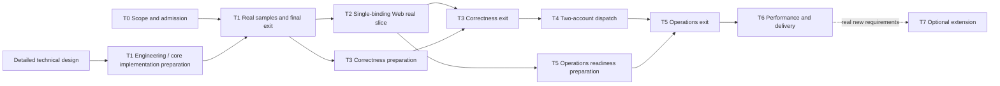

# ANT Implementation Plan

Version: P1.3 · Date: 2026-10-04 · Baseline: PRD V0.12 / DESIGN V0.9 plus detailed technical design · Work item status defers to STATUS.

## Execution Entry Point

2026-10-04 user ruling: Codex has full authority over project implementation, verification, and acceptance. Retain accepted physical deliverables, do not redo T1, do not revoke real inputs or phase gates. Current acceptance is documented in `docs/evidence/T1-CODEX/README.md` and STATUS.

The main entry point is the [project task tree](TASK-TREE.md): 55 leaf tasks and 6 workflows, implemented by Codex according to dependencies and write scopes. The phase acceptance table is in the [execution manifest](execution/README.md). Actual progress still defers to STATUS.

For the historical T1 rework record, see the [independent review](../REVIEW-T1-REWORK3-CODEX.md); for the final accepted state, see STATUS and the T1-CODEX evidence. Proceed onward per the [project task tree](TASK-TREE.md) and the current state; do not redo accepted engineering.

First read the [PRD](../PRD.md), [DESIGN](../DESIGN.md), and [detailed technical design](../design/README.md), then read the execution standard and STATUS. Technical interfaces / tables / algorithms are already provided; for concrete start of work see the [file and method mapping](../design/06-IMPLEMENTATION-MAP.md). When real business inputs are missing, the ready T1.1 engineering and core technical preparation may proceed first; T0 evidence gathering can advance in parallel, without making outbound calls on unverified configuration.

| File | Sole responsibility |
|---|---|
| This file | Phase order, dependencies, roles, and first-version completion conditions |
| TASK-TREE / TASK-INDEX.json / workstreams | Module tree, leaf dependencies, and work item contracts; JSON is the source of node metadata, workflow cards are a readable projection |
| EXECUTION-STANDARD | Work item execution, quality, evidence, change, and resumption standards |
| STATUS | Work item progress, actual owners, D01–D07 decisions, and blocked inputs |
| ACCEPTANCE-MATRIX | Traceability of R/N/A/I to implementation phases and evidence; does not rewrite PRD acceptance |
| 00–07 task cards | Inputs, steps, deliverables, and exits for each phase; status is not recorded twice |

## Phase Order

| Phase / task card | Business capability on completion | Start / exit dependencies | Decision milestones |
|---|---|---|---|
| [T0](00-SCOPE-AND-ADMISSION.md) | One real invocation scenario and admissible accounts | Collection can start immediately; exit only with complete actual evidence | D01–D03/D07 closed; D04 load frozen |
| [T1](01-CONTRACTS.md) | Implementation of agreed interfaces / schema / algorithms, real samples, and verification entry point | Technical preparation may proceed first; exit only when T0 and T1.4 are satisfied | D04 stream budget frozen and closed; D05/D06 specs frozen |
| [T2](02-VERTICAL-SLICE.md) | Minimal Web config → Go API → real DB → pool selection → outbound call → UI result | T1 exit; recheck D03 before real outbound calls | No new decisions |
| [T3](03-CORRECTNESS.md) | Concurrency, cancellation, crash, resource, permission, and recovery correctness | Can be prepared after T1; exit only after real-DB integration and T2 | D06 runtime verification closed |
| [T4](04-MULTI-ACCOUNT.md) | Two real accounts in the pool, heterogeneous resource grouping, manual priority, and safe redistribution | T2/T3 exit | Both providers' evidence still valid |
| [T5](05-OPERATIONS-AND-ONBOARDING.md) | 7 categories of Web pages, config / result / audit, repairs, and backup disposal | Can be prepared after T2; exit after T4 | D05 runtime verification closed |
| [T6](06-PERFORMANCE-AND-DELIVERY.md) | First version meeting targets under frozen load and installable for use | T3–T5 exit | D04 metrics measured in practice; never walk back targets to hide failure |
| [T7](07-EXTENSION.md) | New requirements extended along existing boundaries | T6 passed and clear new requirements exist; may not start | Register scope and applicable evidence separately |

Codex is responsible for the implementation, integration, and final acceptance of each leaf task; shared types, schema, lock ordering, and the composition root keep a single writer. When resources are limited, execute in dependency order; independent acceptance must not be skipped. The interleaving of T2 and T3 means safe behavior exists from the first real outbound call; you cannot first bypass the ledger to get things working and bolt on safety afterward.

## Division of Labor and Integration Responsibility

| Role | Systems / deliverables owned | Handoff conditions |
|---|---|---|
| Project / business | Scenarios, actual callers, account authorization, business success semantics | T0 has real inputs and a test action scope |
| Integration | Codex maintains contracts, catalogue boundaries, composition root, Router, versions, and full paths | Go / Web buildable and end-to-end slice runnable |
| Ledger | Ledger, ResourceSemantics, one LedgerStore, migrations, recovery | Real-DB atomicity, idempotency, invariants, and fault evidence |
| Adapters | ProviderAdapter, domain policies / guards, presets, and provider verification | Encoding/decoding and per-dimension upper bounds are grounded; outbound calls controlled |
| Operations / runtime | Web, Go API, schema forms, pool ordering, authorization queries, config repair, audit / backup | A developer not involved in the work can complete actions and failure handling by following the guide |
| Verification | Concurrency / faults, real closed loops, performance, installation, and final evidence | Test cases repeatable; environment / inputs / actual results complete |

Current work items and artifact links go only into STATUS; integration exits must not be skipped.

## First-Version Completion Conditions

T0–T6 all exited; applicable items of R01–R25, N01–N07, and A01–A30 have evidence; applicable verifications of I01–I10 pass; D01–D07 closed per their respective milestones. A21 applies to email only, and the AI stream requirements apply to AI only; applicability reasons must be registered and must not be silently skipped.

There must be a real UI configuration closed loop, manual priority changing the server's real selection, heterogeneous and cross-pool sharing evidence, a real single binding, two-account dispatch, failure / audit, first-use installation, and performance evidence. The controlled fault server is used to verify races and does not replace real provider records; real provider records likewise do not replace repeatable concurrency / fault tests. T7 does not affect first-version completion.

Effort and calendar dates are estimated after T0 determines the real scenario; this plan controls order via dependencies and exits and does not fabricate schedules. When business materials are missing, collection and verification can still proceed, but D items must not be auto-closed and actual side effects must not begin with a default provider.

Phase business steps follow the 00–07 cards; leaf write scopes and acceptance criteria follow the manifests generated under execution/. Accepted T1 is not redone; after self-check it stays in verifying, and is marked done only after independent acceptance passes; phase gates must not be revoked.

The current baseline has been changed by user ruling to a Go backend plus an independent Web, with the backend owning pool filtering / priority / failover. The old plans for a Node business backend, TS core contracts, library / CLI only, and no console were archived in V0.6. UI configuration, pools, and manual ordering are T1–T5 first-version work, not T7 extension.
